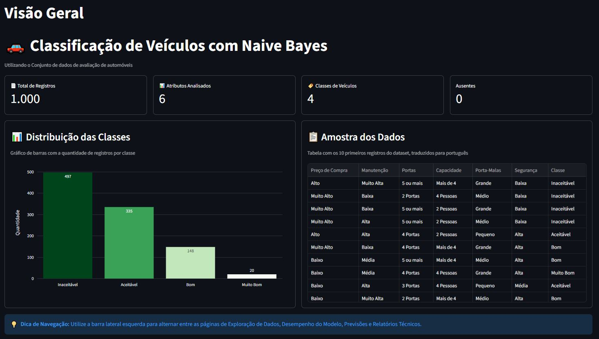
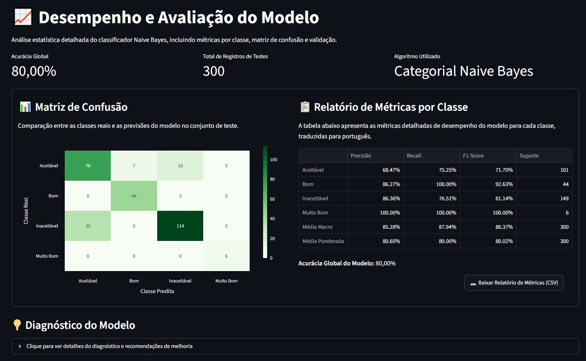
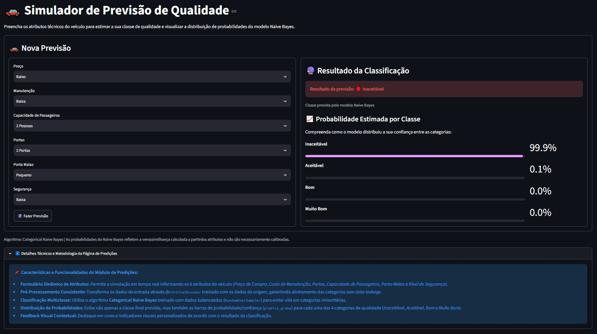

# 🚗 Classificação de Veículos com Naive Bayes


Dashboard interativo que classifica o nível de aceitação de automóveis com base em critérios técnicos, usando o algoritmo **Naive Bayes Categórico**. A aplicação reúne métricas de desempenho do modelo, visualizações e um formulário para realizar novas previsões, tudo em português.

---

## 📌 Sumário

- [Sobre o projeto](#-sobre-o-projeto)
- [Demonstração](#️-demonstração)
- [Funcionalidades](#-funcionalidades)
- [Dataset](#-dataset)
- [Tecnologias](#️-tecnologias)
- [Estrutura do projeto](#-estrutura-do-projeto)
- [Como executar](#-como-executar)
- [Como o modelo funciona](#-como-o-modelo-funciona)
- [Decisões de projeto](#-decisões-de-projeto)
- [Próximos passos](#-próximos-passos)
- [Autor](#-autor)

---

## 🎯 Sobre o projeto

O objetivo é prever a **qualidade de um veículo** a partir de seis atributos (preço, manutenção, portas, capacidade, porta-malas e segurança). O projeto cobre o ciclo completo de uma solução de dados:

1. Carga, limpeza e divisão estratificada dos dados (stratify=y)
2. Balanceamento de treino por amostragem (RandomOverSampler) para neutralizar viés em classes minoritárias
3. Treinamento e avaliação robusta do classificador Categorical Naive Bayes
4. Dashboard gerencial e operacional modularizado em Streamlit
5. Simulação de previsões em tempo real com probabilidade por classe

As classes previstas são:

| Código original | Exibição no dashboard |
|-----------------|-----------------------|
| `unacc` | 🔴 Inaceitável |
| `acc` | 🟡 Aceitável |
| `good` | 🟢 Bom |
| `vgood` | 💎 Muito Bom |

---

```
## 🖼️ Demonstração

### Visão Geral


### Desempenho do Modelo


### Nova Previsão

```

---

## ✨ Funcionalidades

- **KPIs do dataset:** total de registros, número de atributos, classes e valores ausentes
- **Métricas do modelo:** acurácia, precisão, recall e F1-Score (média macro)
- **Medidor (gauge)** com a acurácia geral
- **Amostra de dados** traduzida para português
- **Distribuição das classes** em gráfico de barras
- **Matriz de confusão** interativa
- **Relatório de classificação** por classe
- **Nova previsão:** formulário com seleção dos atributos e resultado colorido conforme a classe prevista
- **Interface 100% em português**, sem alterar os dados usados no treinamento

---

## 📊 Dataset

O projeto utiliza o **Car Evaluation Dataset**, disponível no [UCI Machine Learning Repository](https://archive.ics.uci.edu/dataset/19/car+evaluation), criado a partir de um modelo hierárquico de decisão. O arquivo `data/car.csv` deste repositório contém uma amostra de **1.000 registros**.

| Atributo | Descrição | Valores |
|----------|-----------|---------|
| `buying` | Preço de compra | `vhigh`, `high`, `med`, `low` |
| `maint` | Custo de manutenção | `vhigh`, `high`, `med`, `low` |
| `doors` | Número de portas | `2`, `3`, `4`, `5more` |
| `persons` | Capacidade de passageiros | `2`, `4`, `more` |
| `lug_boot` | Tamanho do porta-malas | `small`, `med`, `big` |
| `safety` | Nível de segurança | `low`, `med`, `high` |
| `class` | **Variável alvo** | `unacc`, `acc`, `good`, `vgood` |

> O dataset é **desbalanceado**: a classe `unacc` concentra quase metade dos registros e `vgood` é a menos frequente. Isso influencia o desempenho do modelo nas classes minoritárias, por isso as métricas são calculadas com média **macro**, que dá o mesmo peso a todas as classes.

---

## 🛠️ Tecnologias

| Biblioteca | Uso no projeto |
|------------|----------------|
| [Streamlit](https://streamlit.io/) | Interface web, layout em colunas, formulário e cache |
| [Pandas](https://pandas.pydata.org/) | Leitura e manipulação dos dados |
| [scikit-learn](https://scikit-learn.org/) | `OrdinalEncoder`, `CategoricalNB`, `train_test_split` e métricas |
| [Plotly](https://plotly.com/python/) | Gráfico de barras, matriz de confusão e medidor |
| [imbalanced-learn](https://scikit-learn.org/) | Balanceamento de classes de treino via `RandomOverSampler` |

---

## 📁 Estrutura do projeto

```
previsao_veiculos/
│
├── app.py                     # Arquivo de redirecionamento ou página raiz
├── requirements.txt           # Dependências do projeto
├── README.md                  # Documentação do projeto
├── data/
│   └── car.csv                # Dataset de avaliação de automóveis
├── models/                    # Modelos salvos e metadados
├── charts/
│   └── charts.py              # Funções gráficas e de relatórios reutilizáveis
└── src/
    ├── __init__.py
    ├── data_loader.py         # Carregamento e tratamento dos dados
    ├── model_training.py      # Pipeline de treino, divisão estratificada e oversampling
    ├── modelo_evaluation.py   # Funções de avaliação estatística
    └── prediction.py          # Lógica de inferência e previsões
└── pages/
    ├── 01_Visão_Geral.py      # KPIs e resumo executivo
    ├── 02_Exploração_de_Dados.py # EDA, filtros avançados e exportação CSV
    ├── 03_Desempenho_do_Modelo.py # Matriz de confusão e métricas estatísticas limpas
    ├── 04_Predições.py        # Simulador interativo com probabilidades por classe
    ├── 05_Relatórios.py       # Documentação técnica e exportação de relatórios
    └── 06_Configurações.py    # Metadados, stack tecnológica e parâmetros
```

| Arquivo | Responsabilidade |
|---------|------------------|
| `utils/data_loader.py` | `load_data()` lê o CSV e `model()` treina o Naive Bayes, devolvendo encoder, modelo e previsões de teste |
| `charts/charts.py` | `metricas()`, `metrics_report()`, `fig_gauge()`, `bar_chart()` e `matriz_confusao()` |
| `app.py` | Monta o layout, traduz os dados para exibição e processa as novas previsões |

---

## 🚀 Como executar

### Pré-requisitos

- Python 3.10 ou superior
- Git

### Passo a passo

**1. Clone o repositório**

```bash
git clone https://github.com/seu-usuario/nome-do-repositorio.git
cd nome-do-repositorio
```

**2. Crie e ative o ambiente virtual**

```bash
# Windows
python -m venv .venv
.venv\Scripts\activate

# Mac / Linux
python3 -m venv .venv
source .venv/bin/activate
```

> No PowerShell, se aparecer erro de permissão, rode antes:
> `Set-ExecutionPolicy RemoteSigned -Scope CurrentUser`

**3. Instale as dependências**

```bash
pip install -r requirements.txt
```

**4. Execute o dashboard**

```bash
streamlit run Principal.py
```

A aplicação abrirá em `http://localhost:8501` ou https://previsaoveiculos.streamlit.app/

### Dependências (`requirements.txt`)

```
streamlit
pandas
numpy
plotly
scikit-learn
```

---

## 🧠 Como o modelo funciona

```
car.csv
   │
   ▼
OrdinalEncoder ──► transforma categorias de texto em números
   │
   ▼
train_test_split ──► 70% treino | 30% teste (random_state=42)
   │
   ▼
CategoricalNB.fit() ──► treina com os dados de treino
   │
   ▼
modelo.predict() ──► gera previsões no conjunto de teste
   │
   ▼
Métricas: acurácia, precisão, recall, F1 e matriz de confusão
```

**Por que Naive Bayes Categórico?** Todos os atributos do dataset são categóricos. O `CategoricalNB` foi desenhado para esse cenário: ele calcula a probabilidade de cada categoria condicionada à classe, assume independência entre os atributos e escolhe a classe mais provável. É rápido, simples e interpretável, o que o torna uma boa linha de base.

### Fluxo de uma nova previsão

1. O usuário escolhe os atributos em português (ex.: "Muito Alto", "5 ou mais")
2. A **tradução reversa** converte cada escolha para o valor original em inglês
3. O mesmo `OrdinalEncoder` do treino aplica `transform` (sem reajustar)
4. O modelo prevê o código da classe
5. O código é convertido de volta para o nome da classe e traduzido para exibição

---

## 💡 Decisões de projeto

- **Dados originais preservados:** a tradução para português acontece apenas na camada de exibição (`df_traduzido`). O modelo é treinado com os valores originais, e uma tradução reversa garante que as entradas do formulário cheguem ao encoder no formato correto.
- **Cache com `@st.cache_data`:** o CSV é lido uma vez, evitando reprocessamento a cada interação.
- **Separação de responsabilidades:** lógica de dados em `utils/`, visualizações em `charts/` e interface em `app.py`.
- **Métricas macro:** em um dataset desbalanceado, a acurácia sozinha esconde o desempenho nas classes raras. Precisão, recall e F1 com média macro mostram esse efeito.
- **Altura padronizada:** tabela, gráfico de barras e matriz de confusão compartilham a mesma altura para um layout alinhado.

---

## 🔭 Próximos passos

- [ ] Comparar com outros algoritmos (Árvore de Decisão, Random Forest, Regressão Logística)
- [ ] Tratar o desbalanceamento de classes (pesos de classe ou reamostragem)
- [ ] Adicionar validação cruzada (`cross_val_score`)
- [ ] Exibir a probabilidade de cada classe na nova previsão
- [ ] Fazer o deploy no Streamlit Community Cloud
- [ ] Adicionar testes automatizados para as funções de `utils/` e `charts/`

---

## 👤 Autor

**Danilo Oliveira dos Santos**

[](https://github.com/DaniloSantos1985) [](https://www.linkedin.com/in/danilo-oliveira-santos-b5b3a1174/)

---

## 📄 Licença

Este projeto está sob a licença MIT. Consulte o arquivo `LICENSE` para mais detalhes.
